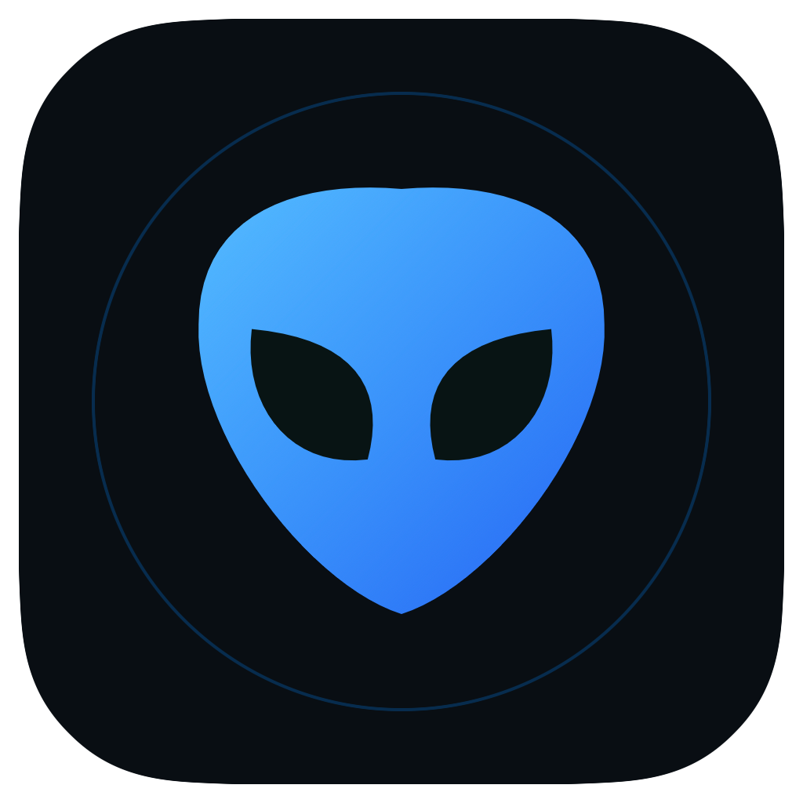
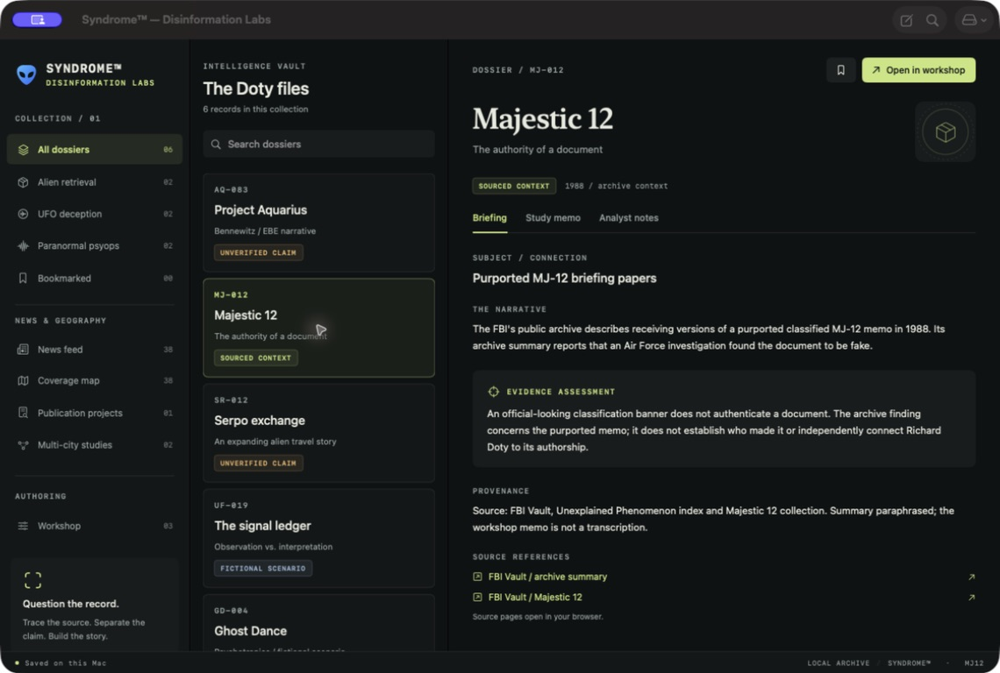

<p align="center">
  
</p>

# Disinformation Labs™

**A native macOS workspace for news research, source review, geographic comparison, and publication tracking.**

Disinformation Labs™ is a standalone Syndrome™ companion app. It combines a Richard Doty / MJ-12 dossier archive, country-specific news snapshots, transparent headline comparisons, regional coverage maps, and a clearly labeled fictional memorandum studio.

[Download the latest release](https://github.com/Rali0s/Disinformation-Labs/releases/latest) · [User guide](docs/user-guide.md) · [Release notes](docs/releases/v1.5.1.md)

## Workspace preview



The Majestic 12 dossier in the macOS app, with the blue alien emblem, archive navigation, evidence assessment, and source references.

## What it does

| Workspace | Capabilities |
| --- | --- |
| Dossier archive | Six curated dossiers, source links, research notes, bookmarks, and search. |
| News feed | Download one selected country's English-language Google News RSS snapshot; filter the cached headlines locally by city or topic. |
| Radius search | Start in Albuquerque, NM, select a reference headline, and explore named places within 10–1,000 miles. |
| Similarity inspector | Inspect shared keywords, adjacent phrases, and seed coverage; adjust weights and thresholds. |
| Multi-city studies | Compare reference articles across 2–12 cities, with separate distance and publication-time comparisons. |
| Coverage map | Explore regional headline counts and manual tone/format annotations on an offline map. |
| Publication projects | Register publications, manually record site analytics and linked mentions, and inspect documented geographic spread. |
| Fictional memo studio | Write and export labeled fictional memoranda in typewriter, fax, or photocopy styles, with paginated PDF output. |

Supported English news editions: **United States, United Kingdom, Canada, Australia, New Zealand, Ireland, India, Singapore, and South Africa**. The bundled place catalog includes 32,350 US places and 23,638 international places. Country and city controls do not download additional feeds until you explicitly refresh.

## Install

1. Download the macOS ZIP from [Releases](https://github.com/Rali0s/Disinformation-Labs/releases).
2. Extract **Disinformation Labs.app** and move it to Applications.
3. Open the app. The first published binary targets **Apple Silicon (arm64), macOS 14 or later**.

The app is ad-hoc signed, not Apple-notarized. macOS may require you to review it in **System Settings → Privacy & Security** before opening. Source builds are available below. The release includes `SHA256SUMS.txt` for checking the downloaded archive:

```sh
shasum -a 256 -c SHA256SUMS.txt
```

Keep the checksum file and ZIP in the same directory when checking.

## Build from source

Requires macOS 14 or later and Apple's Swift command-line tools with Swift 5.9 or newer. There are no third-party Swift packages or API keys.

```sh
git clone https://github.com/Rali0s/Disinformation-Labs.git
cd Disinformation-Labs
zsh scripts/build-app.sh
open "dist/Disinformation Labs.app"
```

The build uses the current Mac's architecture. Only the arm64 release has been validated for this release. Open `Package.swift` in Xcode for development, or run `swift run DisinformationWorkshop`.

```sh
# Deterministic model checks and native PDF/persistence checks
zsh scripts/test.sh

# Re-render the blue alien icon from its SwiftUI vector source
zsh scripts/build-icon.sh

# Build, verify, smoke-test, and package a versioned ZIP with its checksum
zsh scripts/package-release.sh
```

Release output is written to `dist/releases/v1.5.1/`. Generated builds, test PDFs, and local output are excluded from Git.

## How to interpret the results

**Headline similarity is lexical overlap, not proof that stories describe the same event.** Defaults combine keyword overlap (60%), adjacent phrases (30%), and seed coverage (10%), with a minimum of two meaningful shared terms and 40/100. Geography and recency do not inflate this textual score. The inspector shows the contributing terms and limitations.

Evidence confidence is a manual review rubric for provenance, corroboration, context, and geographic relevance. Unreviewed values remain unknown. City matches and suggested regions can be ambiguous and require source review.

Coverage heat maps count articles in the selected cached sample. Tone labels describe an analyst's reading of text. They do not measure reader sentiment, voter opinion, or demographics.

Publication tracking accepts **manual records of both site analytics and linked mentions**. No analytics provider, mention crawler, or publishing service is connected. Page views use the latest recorded cumulative count per publication URL. The sprawl index describes regional dispersion among confirmed external URLs with documented source locations:

```text
Sprawl = 100 × (1 − sum(regionalShare²))
```

No qualifying locations means Unknown; one region scores 0; two equally represented regions score 50. This describes the recorded sample, not audience reach or total web coverage. Full definitions and examples are in the [user guide](docs/user-guide.md).

The memorandum studio labels exports as fictional simulations. Dossier allegations and generated examples are not authenticated government records.

## Data and network behavior

The app stores work locally in:

```text
~/Library/Application Support/SyndromeDisinformationWorkshop/
├── workspace.json   # Memoranda, dossier notes, bookmarks
└── news.json        # News caches, reviews, studies, coverage, publication projects
```

The legacy storage path and bundle identifier remain stable across the rename. Workspace and news archives have separate export/import controls. Backups contain editable, unredacted text.

Feed requests occur on explicit refresh, are limited to the selected country edition, and are capped at 5 MB with a 25-second timeout and 10-second minimum interval. Full articles open in your browser. The app has no automatic refresh, background monitoring, GPS collection, article-body scraping, or map-tile downloads. Google News RSS availability and coverage can change; national snapshots are small samples rather than complete local news databases.

## Project structure

```text
Sources/DisinformationWorkshop/  SwiftUI app, native rendering, state stores
Sources/WorkshopCore/            Models, similarity, geography, persistence
Sources/WorkshopChecks/          Deterministic regression checks
Resources/                      App metadata and icon
scripts/                        Build, validation, packaging, data preparation
docs/                           User guide, release notes, dataset provenance
```

The internal executable remains `DisinformationWorkshop`; the product is **Disinformation Labs™**.

## Credits and licensing

Geographic data uses the US Census Gazetteer, GeoNames (CC BY 4.0), and Natural Earth (public domain). See [geographic data credits](Sources/WorkshopCore/Resources/Geographic-data-credits.txt) for attribution and modifications, and the build manifests in `docs/` for source checksums. News links credit their publishers through Google News RSS; article bodies are not bundled.

No open-source license is currently granted for the application code or branding. Third-party data retains its own stated terms. Disinformation Labs™ and Syndrome™ are the product names used by this project.
